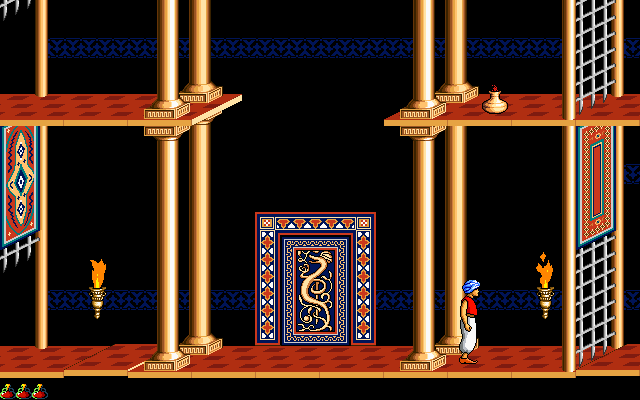
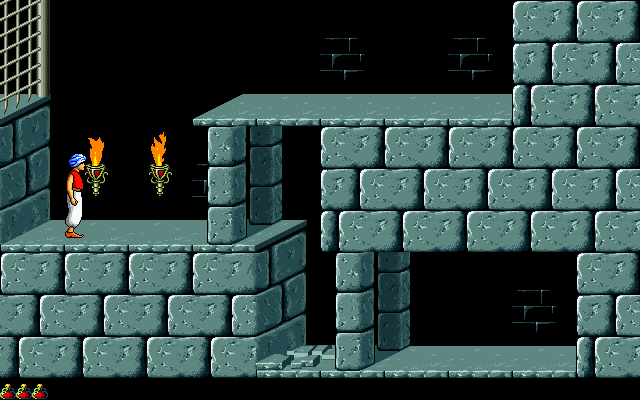
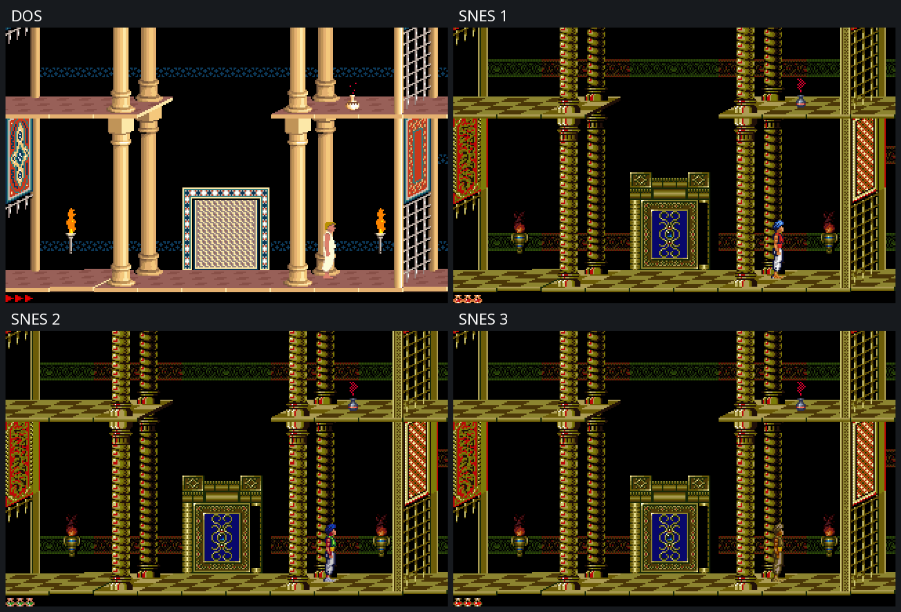
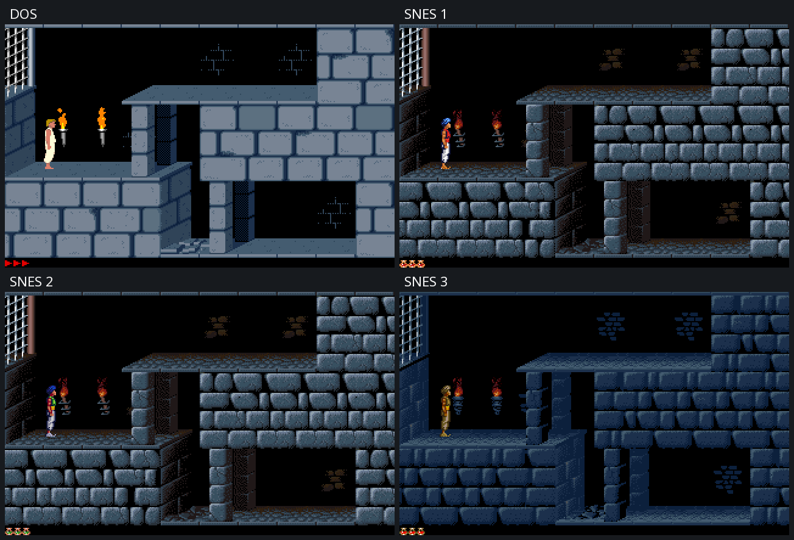

# Prince of Persia Remastered v1.0.0

**A Macintosh HD graphics port for Windows and Linux, with a custom native
640×400 renderer and 2× high-resolution sprite support.**

Prince of Persia Remastered is an independent, unofficial fan project maintained
by [The-Alok](https://github.com/The-Alok). It brings the original Macintosh
colour artwork, sprite origins and scene composition to a modified version of
[SDLPoP by Dávid Nagy and contributors](https://github.com/NagyD/SDLPoP).

The custom renderer uses a **640×400 physical framebuffer** over SDLPoP's
**320×200 logical gameplay canvas**. “2×” describes that rendering scale; the
Macintosh sprites use their original native pixels and SHPD origins.
The project focuses on this Macintosh presentation, its asset handling and
platform builds while retaining SDLPoP's gameplay foundation.

## Gameplay screenshots

### Mac Native FULL

**Palace — Level 5**



**Dungeon — Level 1**



### Other graphics packs

Each grid shows **DOS, SNES 1, SNES 2 and SNES 3**, in that order.

**Palace — Level 5**



**Dungeon — Level 1**



## Download and play

Download the appropriate archive from [Releases](https://github.com/The-Alok/prince-of-persia-remastered/releases).

| Platform | Download | Start |
| --- | --- | --- |
| Windows x64 | `prince-of-persia-remastered-v1.0.0-windows-x86_64.zip` | Extract everything, then double-click `prince.exe` |
| Linux x64 | `prince-of-persia-remastered-v1.0.0-linux-x86_64.tar.gz` | Extract, then run `./launch.sh` |

Windows includes the required SDL runtime DLLs; keep them beside `prince.exe`.
Linux uses the system SDL2 and SDL2_image libraries. On Debian/Ubuntu:

```sh
sudo apt install libsdl2-2.0-0 libsdl2-image-2.0-0
```

The Linux binary's exact glibc/library requirements are recorded in its
`BUILD_INFO.json`. This build requires glibc 2.38 or newer. On older systems,
build from source. Steam Deck compatibility has not been certified.

## What this version adds

- Original Macintosh artwork and SHPD origins at native resolution.
- Native dungeon/palace composition, climbing masks, foreground depth and
  interactive floor, gate, exit, mirror and chomper rendering.
- Original-data sword attachment placement for the Prince and guard families.
- Native cutscene composition, story-card colours, health flasks and RGB fades.
- Five switchable graphics packs in this order: **Mac Native FULL v1.0.0**
  (default), **DOS**, **SNES 1**, **SNES 2**, **SNES 3**.

SDLPoP gameplay, collision, animation timing and replay logic are preserved.
This project has automated visual/reference coverage; it does not claim that
all original-Mac motion has been reproduced or that every level has had a
complete live playthrough. See [RELEASE_NOTES.md](RELEASE_NOTES.md).

## Quick controls

- Arrow keys: move, jump/climb and crouch.
- Shift: grab, careful steps and sword action.
- Esc: menu/settings; F6/F9: quicksave/quickload.
- Ctrl+Tab: record a replay; Tab on the title screen: replay browser.
- Alt+Enter: fullscreen toggle.

Edit `SDLPoP.ini` or use Settings → Visuals. The default remains
`graphics_pack = mac_native_full`. Internal pack IDs are retained for
compatibility even though the three SNES menu labels were renamed.

## Build from source

Linux requires a C compiler, make, pkg-config and SDL2/SDL2_image development
headers. On Debian/Ubuntu:

```sh
sudo apt install build-essential pkg-config libsdl2-dev libsdl2-image-dev
make -C src -j2 CC=/usr/bin/gcc
./prince
```

Windows can be built with MinGW in an MSYS2 MINGW64 shell, or cross-compiled
with the extracted Fedora MinGW toolchain:

```sh
python tools/release/build_windows.py
# Or, from Linux:
python3 tools/release/build_windows.py --toolchain .build/toolchain \
  --sdl2 .build/SDL2-2.32.10/x86_64-w64-mingw32 --output .build/windows-release
```

The Windows script keeps its objects separate from Linux and copies the
runtime DLL dependency closure, PNG codec and applicable SDL3 compatibility
runtime. See its docstring for prerequisites. The exact source for release
v1.0.0 is the [v1.0.0 tag](https://github.com/The-Alok/prince-of-persia-remastered/tree/v1.0.0).

The renderer audit needs Python 3, Pillow and the built Linux objects:

```sh
python3 tools/mac_native_renderer/test_climb_overlay.py \
  --floors --architecture --palace --props --combat --world --ui --cutscenes
```

Independent source-image fixtures used by the tests are included; the original
Macintosh disk image and extracted application resources are not uploaded.
Earlier development/audit notes remain in the repository.

## Issues and contributions

This repository is the home for this Macintosh port's rendering, graphics-pack,
scaling, asset-loading and Windows/Linux build work. Report issues with your
platform, graphics pack, level/room if known, facing direction and a screenshot
or recording. Gameplay regressions observed in this version are welcome too.

## AI assistance disclaimer

This remaster was created with AI assistance from **ChatGPT and Codex**, including
help with coding, debugging, testing and documentation. **The-Alok** directed
development and playtested the game. Original game artwork and upstream code
remain credited to their respective creators below.

## Credits and license

- **Dávid Nagy and all SDLPoP contributors** — engine and gameplay foundation.
- **chanunnaki / SDLPoP-PSP** — graphics-pack implementation/reference used
  during development, with the original mod/graphics authors credited separately.
- **Jordan Mechner and the original Prince of Persia teams** — original game.

Full attribution is in [CREDITS.md](CREDITS.md), including KJ, Maurice Kaltofen
(mk1995) and the source graphics contributors. The complete upstream author
list is preserved in [README.upstream.md](README.upstream.md).

Source is **GPL-3.0-or-later**; see [COPYING](COPYING). Original game artwork
retains its original ownership. Bundled libraries retain their own licenses.
